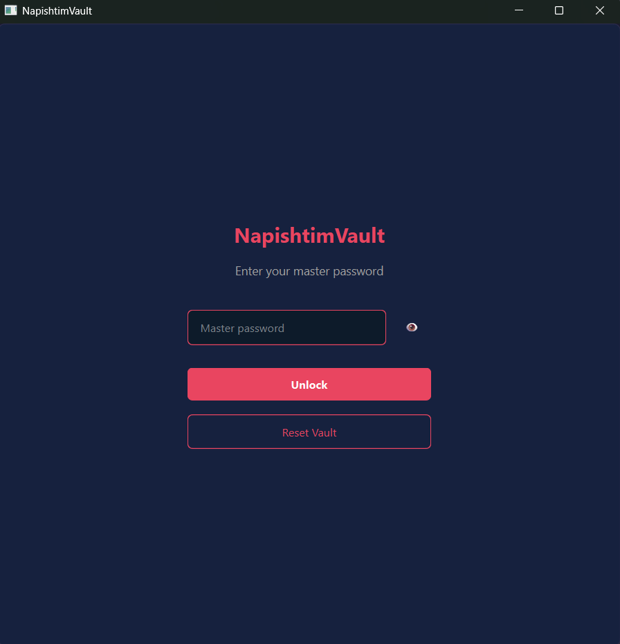
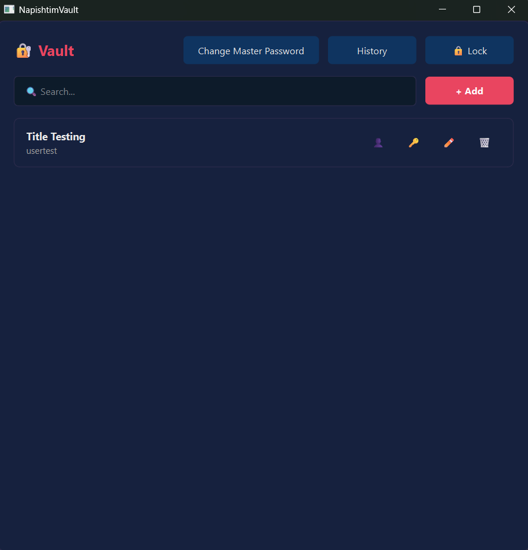

# NapishtimVault

A local-only, minimalist password manager for desktop, built with Python and PyQt6.

This project exists because of my own problem: account credentials scattered across my device in many forms (txt files, photos, etc). NapishtimVault centralizes them in a single encrypted vault, so they stay organized and remain protected if the device is lost or stolen.

The name is derived from one of my favorite games ever, *Ys VI: The Ark of Napishtim* - very fitting, since it is about having a key to open the ark.

> For architecture, system design, and how the code works internally, see [docs/overview.md](docs/overview.md).

## Screenshots

<table>
<tr>
<td align="center" width="50%">
<br>
Login Screen
</td>
<td align="center" width="50%">
<br>
Vault Screen
</td>
</tr>
</table>

## Features

- Master password setup on first launch, unlock on subsequent launches
- Credential **passwords** encrypted with Fernet (key derived from the master password via Scrypt)
- Local SQLite storage - no cloud, no sync, no account
- Instant search by title or username
- Copy username/password to clipboard with 30-second auto-clear
- Built-in password generator (configurable length and character sets)
- Add / edit / delete credentials with title, username, password, URL, and notes
- Activity history (created / edited / deleted events)
- Change master password (re-encrypts all stored passwords)
- Auto-lock after 3 minutes of inactivity or when the window is minimized
- Manual lock button and full vault reset
- Dark, minimalist UI

## Security Model & Limitations

Read this before trusting the app with important credentials.

**What it protects against:**

- Someone obtaining the database file and reading stored **passwords** - they are Fernet-encrypted, and the key exists only while the vault is unlocked
- Passwords lingering in the clipboard - auto-cleared after 30 seconds (see caveats below)
- An unattended, unlocked window - auto-lock after 3 minutes of inactivity or on minimize, which drops in-memory keys

**What it does NOT protect against:**

- **Plaintext metadata.** Only credential *passwords* are encrypted. Titles, usernames, URLs, notes, timestamps, and history entries are stored as readable text inside the SQLite database. The database file itself is **not** encrypted (no SQLCipher).
- **Malware, keyloggers, or screen capture** on the device while you use the app.
- **Memory inspection** while the vault is unlocked - decrypted passwords exist in process memory. Memory wiping on lock is best-effort; Python cannot guarantee keys are erased from RAM.
- **Clipboard managers** or other applications that capture clipboard content before the 30-second clear runs. The app only clears the clipboard if it still contains what *it* copied.
- **A forgotten master password.** There is no recovery and no reset that preserves data. Losing the password means losing the vault.

**Master password rules:**

- Minimum 8 characters (enforced in the UI - use something much stronger; it is your only key)
- Stored indirectly: a salt and an encrypted verifier token are kept in the database; the password itself is never stored
- Changing it re-encrypts every stored credential password with a newly derived key

## Requirements

- Python **3.10+**
- Windows (primary target; Linux/macOS paths are supported for the data directory)
- Dependencies (installed below): `PyQt6`, `cryptography`

## Installation

From the repository root:

```powershell
# 1. Create and activate a virtual environment (PowerShell)
py -m venv .venv
.\.venv\Scripts\Activate.ps1

# 2. Install dependencies
python -m pip install -U pip
python -m pip install -r requirements.txt
```

For Command Prompt instead of PowerShell: `.venv\Scripts\activate.bat`.

## Running the Application

The recommended way (from the repository root, venv active):

```powershell
python run.py
```

Or as a module, with `src/` on the import path:

```powershell
$env:PYTHONPATH = "src"
python -m napishtimvault.app
```

> Do not run `python src/napishtimvault/app.py` directly - the package uses relative imports and it will fail as a standalone script.

## First Launch

1. The app opens the **Setup** screen - create a master password (minimum 8 characters, confirmed twice).
2. The vault is created and unlocked. There is no recovery phrase: **remember this password**.
3. On later launches, enter the master password to unlock.

## Everyday Usage

- **+ Add** - dialog for title, username, password, URL, and notes (dice button opens the password generator)
- **Search box** - filters live by title or username
- Per-entry actions: copy username, copy password, edit, delete (with confirmation)
- **History** - recent created/edited/deleted events
- **Lock** - immediately re-lock and return to the login screen
- **Change Password** - re-encrypts the vault under a new master password

## Change vs. Reset - know the difference

| Action | Effect |
|---|---|
| **Change Password** | Keeps all credentials; re-encrypts them under a new master password |
| **Reset Vault** (login screen) | **Permanently deletes** the local database - every credential and the master password itself. Returns the app to first-run setup |

## Database Location & Backups

The vault is a single SQLite file:

| OS | Path |
|---|---|
| Windows | `%LOCALAPPDATA%\NapishtimVault\vault.db` |
| Linux/macOS | `$XDG_DATA_HOME/NapishtimVault/vault.db`, defaulting to `~/.local/share/NapishtimVault/vault.db` |

Notes:

- There is **no built-in backup, export, or import**. Back up the file manually.
- Back up while the app is **closed**; restoring a backup replaces the current vault.
- Treat backups as sensitive: they contain encrypted passwords plus **plaintext metadata** (titles, usernames, URLs, notes, history).

Example backup (PowerShell):

```powershell
Copy-Item "$env:LOCALAPPDATA\NapishtimVault\vault.db" "$env:USERPROFILE\Desktop\vault-backup.db"
```

## Building the Executable

With the venv active:

```powershell
python -m pip install pyinstaller
pyinstaller --clean --noconsole --name NapishtimVault --onefile --paths src run.py
```

or
```bash
python -m PyInstaller --clean --noconsole --name NapishtimVault --onefile --paths src run.py
```

The executable is created at `dist/NapishtimVault.exe`. The `build/` directory and `NapishtimVault.spec` are generated build artifacts.

## Troubleshooting

- **"Incorrect password" on login** - the master password is the only key; there is no recovery. If truly forgotten, use **Reset Vault** (destroys all data) and start over.
- **`ModuleNotFoundError: napishtimvault`** - you ran the module without `PYTHONPATH` set. Use `python run.py`, or set `$env:PYTHONPATH = "src"` first.
- **Vault shows "corrupted: missing verifier"** - the database exists but its config rows are missing/incomplete. Restore a backup or reset the vault.

## Development

- Lint/format: [ruff](https://docs.astral.sh/ruff/) (included in `requirements.txt`; see `src/format.sh`)
- Formatting and type-checking configuration live in `pyproject.toml`
- Architecture and code walkthrough: **[docs/overview.md](docs/overview.md)**

## License

MIT License - see [LICENSE](LICENSE).
